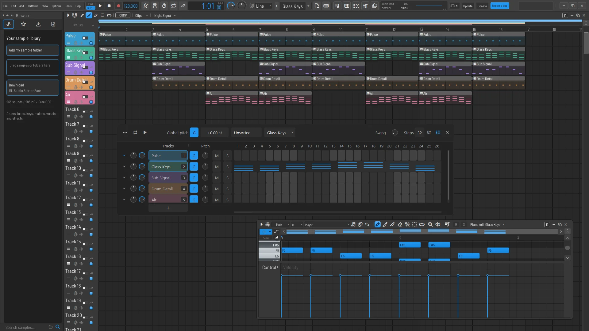
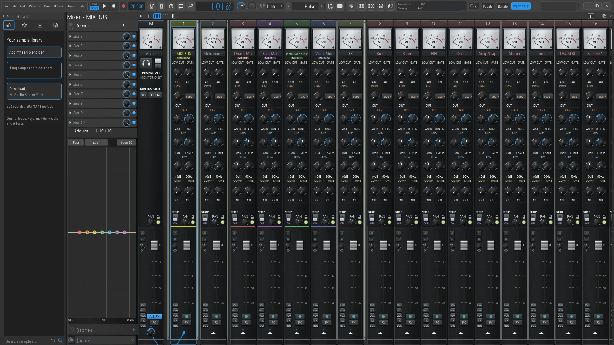
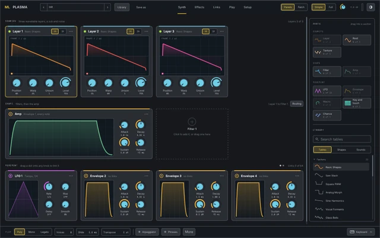

# ML Studio

An open-source digital audio workstation maintained by **Michael Lane**. Compose with patterns and the Piano Roll, arrange and record in the Playlist, and finish the mix with studio-style channel strips and integrated mastering.

[Downloads and change log](https://michaellanemusic.de/ml-studio/) · [Current release](https://github.com/Dorfhaus/ML-Studio/releases/latest) · [Report a bug](https://michaellanemusic.de/lemon-studio/features/feedback.html)

Download ML Studio and its matching source for Windows, Apple silicon and Intel Macs, and Linux x86-64.

## Inside ML Studio

- **Compose and arrange.** Pattern sequencing, Piano Roll editing, MPE, and a Playlist for patterns, audio, and automation.
- **Record and edit.** Mixer input recording, take lanes, comping, stretching, and clip effects.
- **Mix and master.** Analog-style and compact mixers, buses, sends, built-in effects, and the integrated Master Assistant. Compatible third-party plugins are installed separately.
- **Stock synthesizer.** ML Plasma is adapted from Gridline Plasma.

| Mixer | ML Plasma |
| --- | --- |
|  |  |

## Build and contribute

The `michael-lane` branch contains this edition. Install the platform prerequisites from the [upstream build guide](https://github.com/ItsAlphaNeon/Lemon-Studio#getting-started), then run `cargo build --locked --release -p os-app` from this checkout.

For a release build, compile the Master Assistant engine in `plugins/lemon-master-assistant` with CMake and JUCE 8.0.9. Run `python packaging/bundle-master-engine.py --help` to package the resulting VST3 bundle, then set `LEMON_MASTER_BUNDLE` to the ZIP path and `LEMON_RELEASE=1` before building `os-app`.

Work on copies when testing project interchange. Platform availability and testing details are listed in the individual release notes.

## Credits and license

ML Studio is based on [Lemon Studio by ItsAlphaNeon and contributors](https://github.com/ItsAlphaNeon/Lemon-Studio). Original attribution and source history are preserved. See the [license](LICENSE) and [third-party notices](THIRD-PARTY-NOTICES.txt) for component terms.
